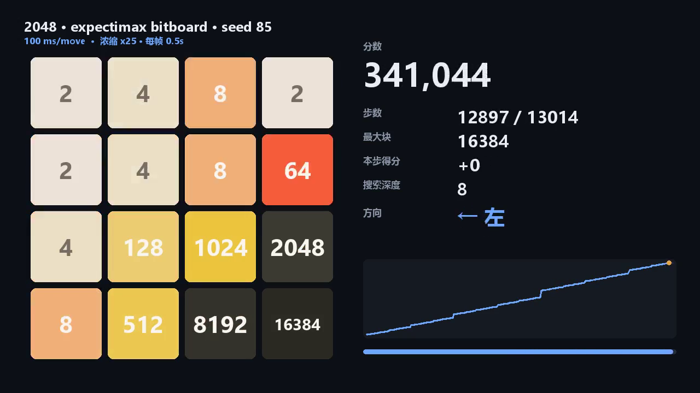

# 2048 AI · bitboard 期望最大引擎

一个能稳定打到 **16384** 的 2048 求解器：把棋盘压成一个 `uint64_t`，用 65536 项行移动表 + 置换表 +
**概率截断**把单核搜索速度做到 **13–18 M 节点/s**，100 ms/步就能搜到 6 层。

| 指标（4×4，100 ms/步，18 局） | 值 |
| --- | --- |
| 均分 | **231,928** |
| 最高 | **387,408**（16384 块） |
| 16384 块率 | **39%** |
| 8192 及以上 | **94%** |
| 实际搜索深度 | 5.9–6.2 |
| 单核速度 | 13–18 M 节点/s |



## 看演示

- **在线交互回放**：<https://q1y1ng.github.io/HEAOZIE/2048-agent/demos/demo.html>
  （13,014 步可拖时间轴、0.1–2 s 定速、1024→32768 里程碑跳转）
- **浓缩视频**：[`demos/demo_condensed.mp4`](demos/demo_condensed.mp4) —— 4:22，每帧 0.5 s、25 步/帧
- 这一局的成绩：**342,816 分 · 16384 块 · 13,014 步**

## 它是怎么工作的

| 模块 | 做法 | 效果 |
| --- | --- | --- |
| 棋盘 | `uint64_t`，16 格 × 4 bit 存 log2 | 移动/比较/TT 键都是单条 64 位指令 |
| 移动 | 65536 项行表（左/右，含得分）；上/下 = 转置后走左/右；一次四方向决策共享 1 次棋盘转置 | 一次移动 4 次查表 |
| 评估 | 行表：行内 `sum^3.5`、单调性 `^4`、合并段数、空格数（权重 270/47/11/700），4 行 + 4 列 | 热路径无 `pow` / `min` |
| 搜索 | 期望最大：chance 节点展开全部空格、2/4 按 0.9/0.1 | 按真实规则计算，不近似 |
| 剪枝 | **概率截断**：累计 spawn 概率 < 1e-4 的分支直接静态评估 | 自适应深度：残局自动搜到 8–10 层 |
| TT | 直映射 2^22 槽，键=整块棋盘+深度，只写"干净值" | 命中率 75–77% |
| 根 | 迭代加深 + 着法排序 + 时间预算，超时层保留已完成的较优值 | 少浪费 20–40% 预算 |

## 三个实验教训（都写进了文档）

1. **深度 ≠ 强度**：搜索里忽略 10% 概率的 4 号块，平均深度从 5.31 涨到 6.05，均分却从 126k 掉到 64k
   （最差一局只到 512）。少算真实概率分布 = 用深度换幻觉。
2. **6 局样本测不出 2 倍以内的差异**：权重扫描第一批显示"空格权重 400 让均分 +1.9 倍"，
   换一批种子后差异完全消失（235k vs 223k）。任何权重实验都要 ≥20 局/臂 + 换种子复验。
3. **并发会吃掉时间预算**：8 并发时 15–18 M 节点/s，12 并发只有 11–12 M；200/400 ms 的成绩并没比 100 ms 好。

## 快速开始

```bash
# 编译（clang 16+ / MSVC 均可，C++17）
clang++ -O3 -std=c++17 -D_CRT_SECURE_NO_WARNINGS -o engine_bb engine_bb.cpp

# 自检：与独立的逐格实现对比转置/四方向移动/得分/评估（20 万随机局面）
./engine_bb --selftest

# 跑一局（--save 落盘逐步 JSON，可再生成视频/回放）
./engine_bb --games 1 --budget 100 --seed 85 --save game.json

# 10 局并行统计
python bench.py --exe engine_bb --seeds 10 --budget 100 --parallel 10 --start-seed 81 --save-dir runs/batchG

# 只测速度与深度，不跑完整局
./engine_bb --bench-moves 200 --budget 100
```

出视频 / 出回放（Pillow 直出帧走 ffmpeg，不需要浏览器）：

```bash
python build_engine_demo.py game.json --out demo.html
python render_video.py game.json --out demo.mp4 --target-seconds 260 --fps 2   # 自动算步长凑 4:22
node demo_smoke.js demo.html                                                   # 无浏览器冒烟测试
```

## 5×5 顺带验证

通用数组引擎（`engine.cpp --size 5`，30 ms/步，深度仅 3.2）就已经 **5/6 上 16384、1 局 32768（833,740 分）**。
棋盘越大越宽容：同样的评估函数，5×5 用 4×4 三分之一的深度拿到了 4×4 至今没拿到的 32768。

## 目录

```
nn2048/engine_bb.cpp      4×4 bitboard 引擎（含 --selftest / --bench-moves / --trace-every）
nn2048/engine.cpp         通用 N×N 数组引擎（5×5 / 6×6，慢但兼容）
nn2048/bench.py           N 局并行 + 逐局落盘 + 统计
nn2048/analyze_game.py    对局阶段分析（里程碑步数、分/步、空格数）
nn2048/render_video.py    逐步 JSON → mp4
nn2048/build_engine_demo.py  逐步 JSON → 自包含交互回放
nn2048/demo_smoke.js      回放页的无浏览器冒烟测试
nn2048/RESULTS.md         全部实测数据、权重扫描、负结果
nn2048/NIGHT_REPORT.md    夜间优化报告（时间线、结论、下一步）
demos/                    演示产物（视频 / 回放 / 封面）
```

## 下一步

4×4 的 32768 需要 25,000 步不犯致命错误，靠加大预算或调权重都无效（见 `RESULTS.md` §6）——
只剩**学习型评估**一条路：用这个引擎做 self-play 数据源，训 n-tuple TD / 小 CNN 替换 `evaluate()`。

## 致谢

- 评估口径（`sum^3.5` / `mono^4` / 合并段 / 空格，权重 270-47-11-700）参考了
  [nneonneo/2048-ai](https://github.com/nneonneo/2048-ai) 的公开实现思路，代码为独立实现。
- 游戏规则源自 [2048](https://github.com/gabrielecirulli/2048)（Gabriele Cirulli, MIT）。

## 许可

本仓库（代码、文档、demos/ 演示产物）与 Release 里的 n-tuple 权重均为 **Apache License 2.0**。

- [LICENSE](LICENSE)：Apache-2.0 全文
- [NOTICE](NOTICE)：版权声明与第三方归属（2048 游戏规则源自 [gabrielecirulli/2048](https://github.com/gabrielecirulli/2048)（MIT），
  评估口径参考 [nneonneo/2048-ai](https://github.com/nneonneo/2048-ai)（MIT）；两者均未复制源码）
- 转载请保留 LICENSE 与 NOTICE；修改过的文件需标注改动（Apache-2.0 §4）